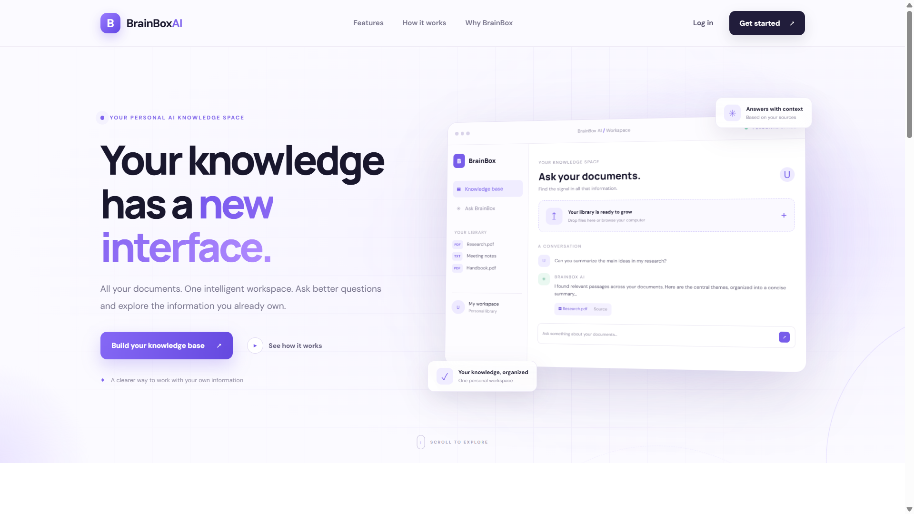
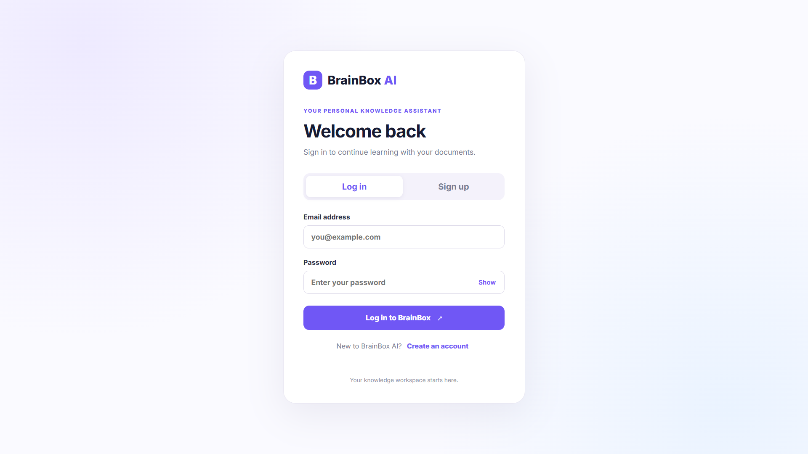
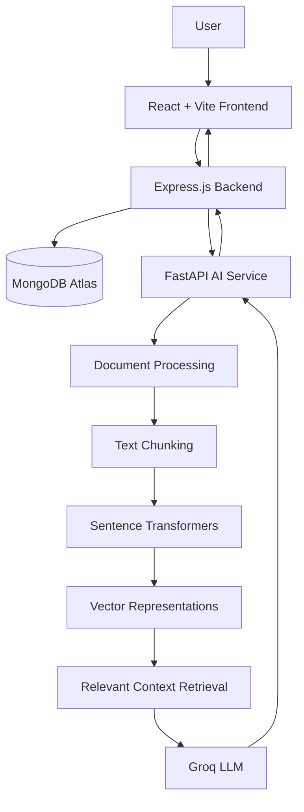

# 🧠 BrainBox AI — Your Personal AI Knowledge Workspace

<p align="center">
  <strong>Turn your documents into an intelligent, searchable knowledge base.</strong>
</p>

<p align="center">
  An AI-powered document assistant built with React, Node.js, Express, FastAPI, MongoDB, RAG, and Groq.
</p>

<p align="center">
  
  
  
  
  
</p>

<p align="center">
  <a href="https://github.com/Utkarsh-Raj-Profile/Brainbox-ai">Repository</a> •
  <a href="#-features">Features</a> •
  <a href="#-architecture">Architecture</a> •
  <a href="#-getting-started">Getting Started</a> •
  <a href="#-author">Author</a>
</p>

---

## ✨ Overview

**BrainBox AI** is an AI-powered document knowledge assistant that transforms static documents into an interactive knowledge experience.

Instead of manually searching through lengthy PDFs and documents, users can upload their files, ask natural-language questions, and receive AI-generated answers grounded in relevant document content.

Powered by **Retrieval-Augmented Generation (RAG)**, BrainBox AI connects document retrieval with large language model capabilities to make personal information easier to explore and understand.

### 💡 The idea

> Your documents contain knowledge. BrainBox AI helps you have a conversation with it.

---

## 🖥️ Preview

### Landing Page



### Authentication Interface



---

## 🚀 Features

| Feature | Description |
|---|---|
| 📄 Document Management | Upload and manage documents in your personal knowledge workspace. |
| 🧠 AI-Powered Q&A | Ask natural-language questions about your uploaded documents. |
| 🔍 RAG Pipeline | Retrieve relevant document chunks to provide contextual answers. |
| 💬 Conversational Interface | Interact with your knowledge base through a chat interface. |
| 🔐 Authentication | Secure user registration and login using JWT authentication. |
| 👤 User Isolation | Associate documents and conversations with their respective users. |
| ⚡ Dedicated AI Service | Separate Python-based AI service for retrieval and generation. |
| 🗂️ Conversation Management | Organize and manage previous conversations. |

---

## 🏗️ Architecture

BrainBox AI follows a modular architecture that separates the frontend, application backend, and AI processing service.



### 🔄 How it works

1. **Document Upload:** Users upload documents through the React interface.
2. **Backend Processing:** Express handles authentication, document ownership, and API requests.
3. **Text Extraction:** The AI service processes document content.
4. **Chunking & Embeddings:** Text is divided into meaningful chunks and converted into vector representations.
5. **Retrieval:** Relevant chunks are retrieved based on the user's question.
6. **AI Generation:** Groq generates a response using the retrieved document context.
7. **Response Delivery:** The answer is returned to the frontend through the backend API.

---

## 🛠️ Technology Stack

### Frontend
- React.js
- Vite
- JavaScript
- HTML5
- CSS3

### Backend
- Node.js
- Express.js
- REST APIs
- JWT Authentication

### Artificial Intelligence & RAG
- Python
- FastAPI
- Retrieval-Augmented Generation (RAG)
- Sentence Transformers
- Text Embeddings
- Groq API

### Database & Infrastructure
- MongoDB
- MongoDB Atlas
- Git
- GitHub

---

## 📂 Project Structure

```text
Brainbox-ai/
│
├── ai-service/
│   ├── app/
│   │   └── main.py
│   └── requirements.txt
│
├── client/
│   ├── public/
│   ├── src/
│   │   ├── assets/
│   │   ├── components/
│   │   ├── App.jsx
│   │   ├── App.css
│   │   └── main.jsx
│   ├── package.json
│   └── vite.config.js
│
├── server/
│   ├── src/
│   │   ├── middleware/
│   │   ├── routes/
│   │   ├── db.js
│   │   └── index.js
│   ├── package.json
│   └── package-lock.json
│
├── docs/
│   └── images/
│
└── .gitignore
```

---

## ⚙️ Getting Started

Follow these instructions to run BrainBox AI locally.

### Prerequisites

Make sure you have installed:

- [Node.js](https://nodejs.org/)
- [Python](https://www.python.org/)
- [MongoDB Atlas](https://www.mongodb.com/cloud/atlas)
- [Groq API Key](https://console.groq.com/)

### 1. Clone the Repository

```bash
git clone https://github.com/Utkarsh-Raj-Profile/Brainbox-ai.git

cd Brainbox-ai
```

### 2. Configure the AI Service

```bash
cd ai-service

python -m venv .venv
```

Activate the virtual environment.

**Windows:**

```powershell
.venv\Scripts\activate
```

**macOS / Linux:**

```bash
source .venv/bin/activate
```

Install dependencies:

```bash
pip install -r requirements.txt
```

Configure the required AI environment variables in your local `.env` file.

Start the FastAPI service using the application entry point configured in the project.

### 3. Configure the Backend

Open another terminal:

```bash
cd server

npm install
```

Configure the required environment variables in `server/.env`.

Start the backend using the appropriate script defined in `server/package.json`.

### 4. Configure the Frontend

Open another terminal:

```bash
cd client

npm install
```

Configure the frontend API URL in `client/.env`, using the variable name expected by the application.

Start the development server:

```bash
npm run dev
```

Open the local URL displayed by Vite in your browser.

---

## 🔐 Environment Variables

Create separate `.env` files for the frontend, backend, and AI service.

The following are example configuration names; verify them against the current source code before use.

### Backend — `server/.env`

```env
PORT=5000
MONGODB_URI=your_mongodb_connection_string
JWT_SECRET=your_strong_jwt_secret
CLIENT_URL=http://localhost:5173
AI_SERVICE_URL=http://localhost:8000
```

### AI Service — `ai-service/.env`

```env
GROQ_API_KEY=your_groq_api_key
GROQ_MODEL=your_groq_model
```

### Frontend — `client/.env`

```env
VITE_API_BASE_URL=http://localhost:5000/api
```

⚠️ **Security:** Never commit real `.env` files, API keys, JWT secrets, database credentials, or private user documents to GitHub.

---

## 🔌 API Modules

The Express backend is organized into modular API routes.

| Module | Endpoint |
|---|---|
| Authentication | `/api/auth` |
| Documents | `/api/documents` |
| Questions | `/api/questions` |
| Conversations | `/api/conversations` |

The FastAPI service handles AI-related processing, document ingestion, retrieval, and question answering.

---

## 🧠 Key Engineering Concepts

BrainBox AI brings together several important concepts in modern full-stack and AI engineering:

- **Retrieval-Augmented Generation:** Grounding AI responses in retrieved document content.
- **Semantic Search:** Finding relevant information using vector representations.
- **Embeddings:** Converting text into numerical representations for similarity-based retrieval.
- **REST API Design:** Separating frontend and backend responsibilities.
- **Authentication & Authorization:** Protecting user-specific resources.
- **Microservice Architecture:** Separating AI processing from the main application backend.
- **Database Modeling:** Managing users, documents, and conversations.

---

## 🗺️ Future Improvements

- [ ] Production deployment with cloud hosting.
- [ ] More document formats and improved extraction.
- [ ] Advanced semantic search and retrieval optimization.
- [ ] Better source references and answer traceability.
- [ ] Improved document analytics.
- [ ] Automated testing and CI/CD.
- [ ] Performance and scalability improvements.

---

## 🤝 Contributing

Suggestions, bug reports, and contributions are welcome.

1. Fork this repository.
2. Create a feature branch.
3. Commit your changes.
4. Open a Pull Request.

---

## 👨‍💻 Author

### Utkarsh Raj

Computer Science Engineer | Full-Stack Developer | AI Enthusiast

I enjoy building practical software solutions using modern web technologies, backend systems, and AI-powered applications.

<p>
  <a href="https://github.com/Utkarsh-Raj-Profile">
    
  </a>
  <a href="https://utkarshraj-portfolio.vercel.app/">
    
  </a>
</p>

---

<p align="center">
  <strong>Built with ❤️ by Utkarsh Raj</strong>
  <br />
  <sub>BrainBox AI — Your knowledge. Your intelligence. One workspace.</sub>
</p>
