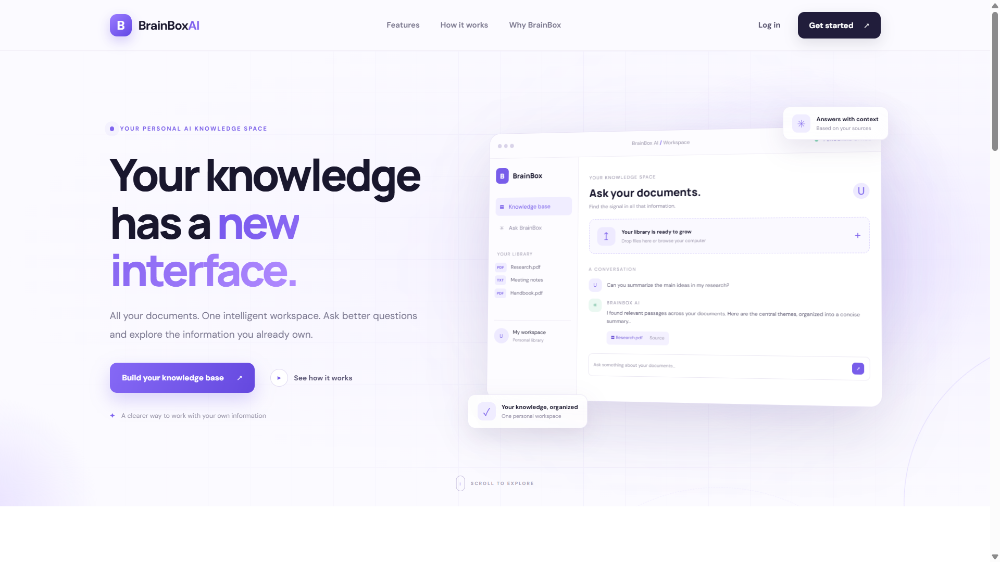
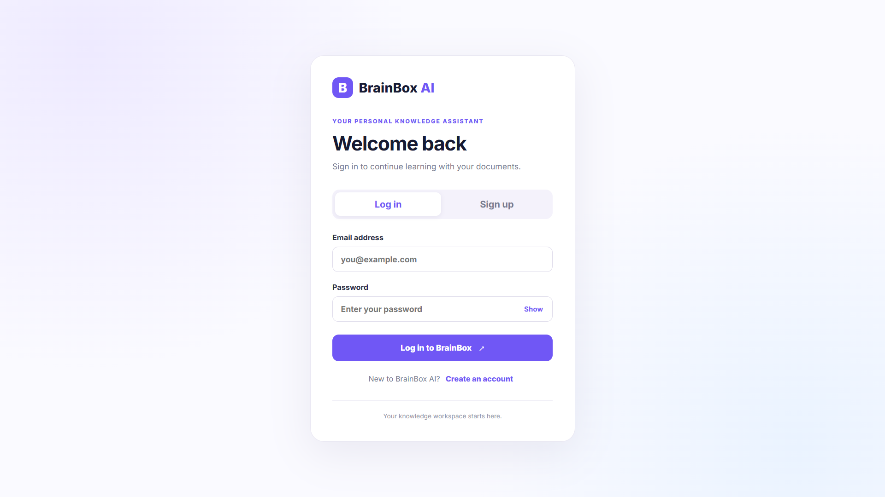
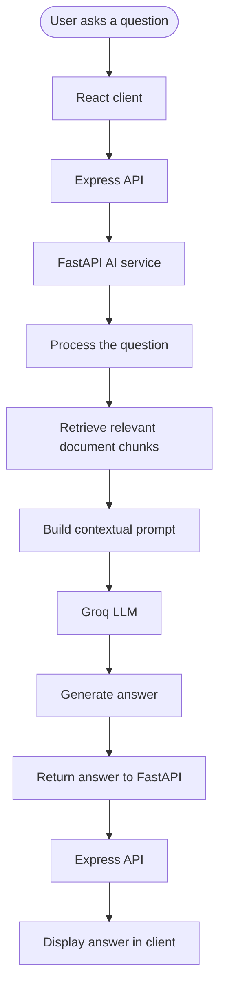
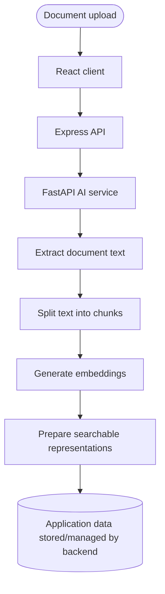

<div align="center">

# 🧠 BrainBox AI

### Your documents. Your knowledge. One intelligent workspace.

**Turn scattered files into a searchable knowledge base — then ask questions and get answers grounded in your own information.**

<p>
  <a href="https://brainbox-ai-mu.vercel.app/"><strong>🚀 Live Demo</strong></a>
  &nbsp;·&nbsp;
  <a href="https://github.com/Utkarsh-Raj-Profile/Brainbox-ai"><strong>📦 Source Code</strong></a>
</p>

<p>
  
  
  
  
  
</p>

<p>
  
  
  
</p>

</div>

---

## ✨ The idea

Your important information is spread across PDFs, notes, reports, and documents. Finding one specific answer can mean opening files, searching manually, and piecing together details yourself.

**BrainBox AI turns that process into a conversation.**

Upload documents to your personal workspace, ask questions in natural language, and let a Retrieval-Augmented Generation (RAG) pipeline find relevant passages before an LLM generates a contextual response.

> **Less searching through files. More time using what you know.**

## 🖥️ Product preview

<div align="center">
  
  <br />
  <em>The BrainBox AI landing page</em>
</div>

<div align="center">
  
  <br />
  <em>Authentication interface</em>
</div>

> If these preview images are not present in your local clone, add screenshots at `docs/images/landing-page.png` and `docs/images/login-page.png`, or update the paths above.

## 🚀 What it does

| Capability | What it means |
|---|---|
| 📄 **Personal document library** | Upload and manage documents in one knowledge workspace. |
| 💬 **Ask questions naturally** | Query your uploaded information using a conversational interface. |
| 🧠 **Context-aware answers** | Retrieve relevant document content and use it as context for AI-generated responses. |
| 🔎 **Semantic retrieval** | Use text embeddings and similarity-oriented retrieval to find relevant passages. |
| 🔐 **Authentication** | Register and log in with JWT-based authentication. |
| 👤 **User-scoped data** | Associate documents and conversations with their respective users. |
| 🗂️ **Conversation management** | Keep track of previous conversations. |
| ⚙️ **Separated AI service** | Keep AI processing in a dedicated Python/FastAPI service, separate from the Express backend. |

## 🧭 How it works

BrainBox AI uses a modular, three-part application architecture:

1. **React + Vite client** — provides the user interface for authentication, document uploads, and conversations.
2. **Express API server** — handles application routes, authentication, user-related operations, and communication with the AI service.
3. **FastAPI AI service** — processes document content, creates chunks and embeddings, retrieves relevant context, and requests a response from Groq.

### RAG request lifecycle



### Document ingestion lifecycle



*The diagrams describe the documented application flow at a high level. Exact persistence and retrieval implementation details may evolve with the codebase.*

## 🧰 Technology

| Layer | Technologies |
|---|---|
| Frontend | React, Vite, JavaScript, HTML5, CSS3 |
| Application backend | Node.js, Express.js, REST APIs |
| AI service | Python, FastAPI |
| Retrieval & language models | RAG, Sentence Transformers, text embeddings, Groq API |
| Database | MongoDB / MongoDB Atlas |
| Authentication | JSON Web Tokens (JWT) |
| Development & source control | Git, GitHub |

## 🏛️ Repository layout

```text
Brainbox-ai/
│
├── ai-service/
│   ├── app/
│   │   └── main.py
│   └── requirements.txt
│
├── client/
│   ├── public/
│   ├── src/
│   │   ├── assets/
│   │   ├── components/
│   │   ├── App.jsx
│   │   ├── App.css
│   │   └── main.jsx
│   ├── package.json
│   └── vite.config.js
│
├── server/
│   ├── src/
│   │   ├── middleware/
│   │   ├── routes/
│   │   ├── db.js
│   │   └── index.js
│   ├── package.json
│   └── package-lock.json
│
├── docs/
│   └── images/
│
└── .gitignore
```

## ⚡ Run locally

### Prerequisites

Install the following before starting:

- [Node.js](https://nodejs.org/)
- [Python](https://www.python.org/)
- [MongoDB Atlas](https://www.mongodb.com/cloud/atlas) account or a compatible MongoDB instance
- [Groq API key](https://console.groq.com/)
- Git

### 1. Clone the project

```bash
git clone https://github.com/Utkarsh-Raj-Profile/Brainbox-ai.git
cd Brainbox-ai
```

### 2. Set up the AI service

```bash
cd ai-service
python -m venv .venv
```

Activate the virtual environment:

**Windows PowerShell**
```powershell
.venv\Scripts\Activate.ps1
```

**macOS / Linux**
```bash
source .venv/bin/activate
```

Install Python dependencies:

```bash
pip install -r requirements.txt
```

Create the AI service environment file and add the configuration required by the application. Then start FastAPI using the entry point and command configured in the project.

### 3. Set up the Express backend

Open a second terminal from the project root:

```bash
cd server
npm install
```

Create `server/.env` and configure the database, authentication, client, and AI-service settings required by the backend. Start the server using the script defined in `server/package.json`.

### 4. Set up the React client

Open another terminal from the project root:

```bash
cd client
npm install
```

Create `client/.env` and set the API base URL using the environment variable expected by the frontend. Start Vite:

```bash
npm run dev
```

Open the local URL printed by Vite.

### 5. Keep the services running

For the complete application, run the AI service, Express backend, and Vite frontend in their respective terminals. Make sure the URLs and ports configured by each service point to the correct local services.

> **Configuration note:** The exact start commands and environment-variable names should be confirmed against the current `package.json` files and source code. They are intentionally not guessed here.

## 🔑 Environment configuration

Create separate environment files for each service. The names below reflect the configuration convention documented for this project; verify each variable against the implementation before running.

**`server/.env`**
```env
PORT=5000
MONGODB_URI=your_mongodb_connection_string
JWT_SECRET=replace_with_a_long_random_secret
CLIENT_URL=http://localhost:5173
AI_SERVICE_URL=http://localhost:8000
```

**`ai-service/.env`**
```env
GROQ_API_KEY=your_groq_api_key
GROQ_MODEL=your_groq_model
```

**`client/.env`**
```env
VITE_API_BASE_URL=http://localhost:5000/api
```

### Security essentials

- Never commit `.env` files, API keys, JWT secrets, or database credentials.
- Keep secrets on the server side; do not expose private credentials through frontend environment variables.
- Do not upload confidential documents unless you understand how and where the application processes and stores them.
- Use a strong, unique JWT secret outside local development.
- Review authorization checks whenever adding or changing document and conversation endpoints.

## 🔌 API surface

The Express backend is organized around these documented route modules:

| Module | Base path |
|---|---|
| Authentication | `/api/auth` |
| Documents | `/api/documents` |
| Questions | `/api/questions` |
| Conversations | `/api/conversations` |

The FastAPI service is responsible for AI-oriented work such as document ingestion, retrieval, and question answering.

## 🧠 Engineering highlights

This project brings together several practical full-stack and applied-AI patterns:

- **Retrieval-Augmented Generation:** retrieve supporting content before generating an answer.
- **Embeddings:** represent text numerically to support similarity-based retrieval.
- **Document chunking:** break long documents into smaller passages that can be retrieved as context.
- **Service separation:** isolate AI workloads behind a dedicated FastAPI service.
- **RESTful communication:** keep the client, application API, and AI service responsibilities distinct.
- **Authentication and authorization:** protect user-specific application resources.
- **Persistence:** use MongoDB for application data.

## 🗺️ Roadmap

Potential next steps for the project:

- [ ] Add automated tests for frontend, backend, and AI-service workflows.
- [ ] Expand supported document formats and extraction quality.
- [ ] Improve retrieval quality, ranking, and chunking strategies.
- [ ] Add more transparent source references for generated answers.
- [ ] Add document-level processing status and error visibility.
- [ ] Improve observability, structured logging, and failure handling.
- [ ] Add CI/CD checks and deployment documentation.
- [ ] Evaluate performance and scalability under larger document collections.

## 🤝 Contributing

Ideas, bug reports, and pull requests are welcome.

1. Fork the repository.
2. Create a focused branch: `git checkout -b feat/your-change`.
3. Make and test your changes.
4. Commit with a clear message.
5. Open a pull request describing the change and its impact.

For substantial changes, consider opening an issue first to discuss the approach.

## 👨‍💻 Author

<div align="center">

### Utkarsh Raj

**Computer Science Engineer · Full-Stack Developer · AI Enthusiast**

Building practical software at the intersection of web engineering and applied AI.

<p>
  <a href="https://github.com/Utkarsh-Raj-Profile">
    
  </a>
  <a href="https://utkarshraj-portfolio.vercel.app/">
    
  </a>
</p>

</div>

---

<div align="center">

**⭐ If BrainBox AI is useful to you, consider starring the repository.**

Built with ❤️ by **Utkarsh Raj**

*BrainBox AI — Your knowledge. Your intelligence. One workspace.*

</div>
